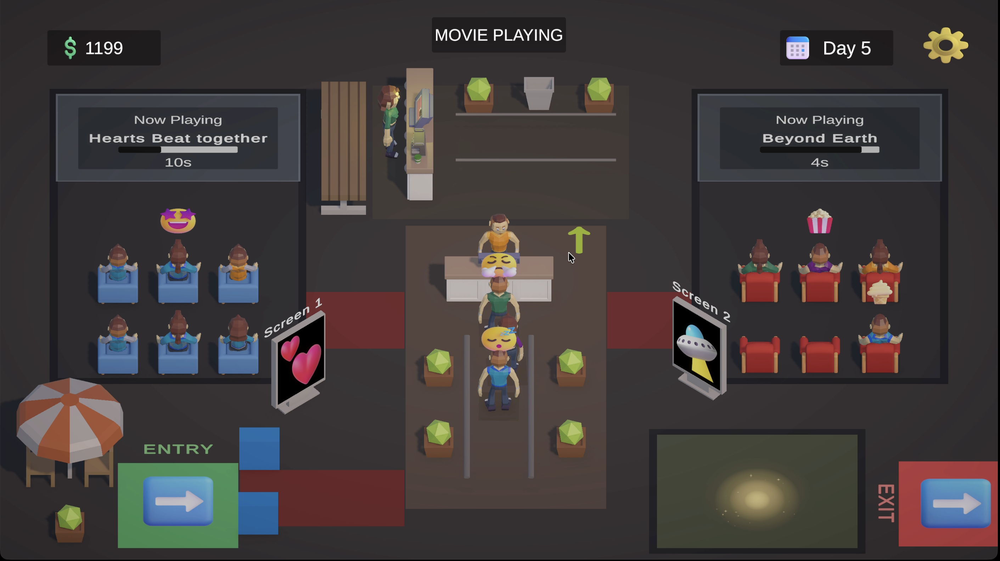
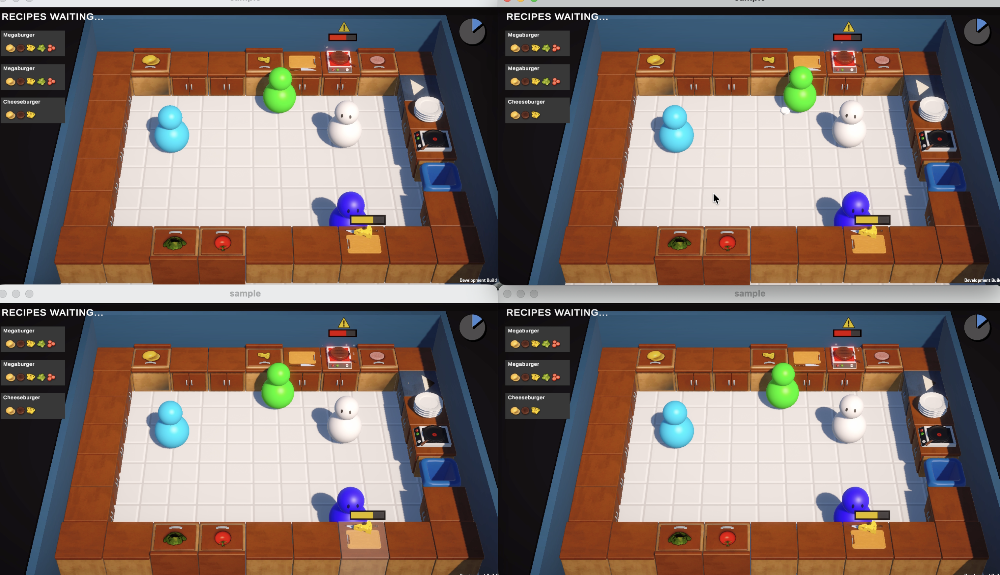

# Hi, I'm JayForge 👋

I'm a **Unity Developer** focused on building gameplay systems, interactive experiences, and simulation-style games using **Unity and C#**.

My work includes developing gameplay mechanics, AI navigation, player interactions, progression systems, and multiplayer functionality through independent game projects and hands-on learning.

## 🛠️ Technical Skills

- **Game Engine:** Unity 6
- **Programming:** C#
- **Gameplay Development:** Player Movement, Interactions, AI Navigation, NavMesh, Coroutines
- **Game Systems:** Progression, Economy, Save/Load, UI, Scene Management
- **Multiplayer:** Netcode for GameObjects
- **Tools:** Git, TextMeshPro, DOTween, PlayerPrefs
- **Other:** Debugging, Bug Identification, Gameplay Testing, Playtesting

## 🎮 Game Development Projects

### Cinema Rush | Unity 6, C#

An idle cinema management simulation featuring customer AI, queue management, economy, and progression systems.

**Highlights:**
- Customer AI and NavMesh navigation.
- Queue management and customer interactions.
- Economy, upgrades, and progression.
- UI implementation and save/load functionality.

**[Play Cinema Rush](https://jayforge.itch.io/cinema-rush)**

### Kitchen Chaos | Unity, C#, Netcode for GameObjects

A kitchen-based gameplay project developed in single-player and multiplayer versions, exploring Unity gameplay systems and multiplayer networking.

**Highlights:**
- Player movement, interactions, and object handling.
- Gameplay mechanics and system implementation.
- Multiplayer functionality using Unity Netcode for GameObjects.
- Networked player interactions and object synchronization.

**[Multiplayer – GitHub](https://github.com/jayforge-dev/unity-tutorial-kitchenchaos-multiplayer)** | **[Single Player – GitHub](https://github.com/jayforge-dev/Unity-Tutorial-KitchenChaos-Recreation)**

## 📬 Contact

- **GitHub:** [JayForge](https://github.com/jayforge-dev)  
- **itch.io:** [JayForge](https://jayforge.itch.io)
- **Email:** [jayforge.dev@outlook.com](mailto:jayforge.dev@outlook.com)
